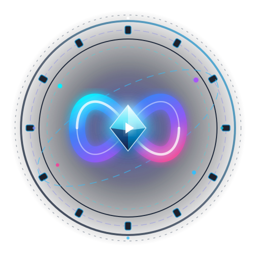

# Antigravity GIF Studio 🎬⚡

<div align="center">
  
  <p><strong>Official Antigravity Plugin & MCP Server for Mathematically Seamless Animated SVGs & GIFs</strong></p>
  <p><em>Zero Cloud API Keys • 100% Local Chromium Time-Stepping • Generative UI Preview Widgets • NeuQuant Palette Optimization</em></p>
</div>

---

## Overview

**Antigravity GIF Studio** empowers coding agents and developers to design, simulate, preview, optimize, and render mathematically seamless looping vector animations and high-performance animated GIFs directly on their local machine.

Traditional LLM-generated animated SVGs and GIFs suffer from recurring flaws:
- **Harmonic Period Mismatches**: Independent elements animated at mismatched durations (e.g. 2.8s vs 3.5s) create jarring snaps at the loop boundary.
- **Velocity Jerks**: Reversal boundaries that switch instantly without smooth cosine easing.
- **Coordinate Swing**: SVG transforms defaulting to canvas `(0, 0)` rather than element centers.
- **Bloated Color Banding**: Heavy gradients degrading into noisy dithering under GIF's 256-color limit.

Antigravity GIF Studio resolves these challenges through a unified tri-part architecture:
1. **Local MCP Server**: Headless Chrome/Edge DevTools Protocol (CDP) time-stepping and `gifenc` NeuQuant quantization for frame-accurate offline rendering.
2. **Generative UI Preview Widget**: Standalone, single-file interactive HTML preview artifacts supporting live playback, timeline scrubbing, variable speed (0.25x–3x), background toggles, and instant client-side GIF re-encoding.
3. **Motion Design Skill (`skills/gif-studio/SKILL.md`)**: A specialized domain skill guiding LLMs through mathematical loop closure formulas, transform anchoring, and color discipline.

---

## Key Features

- **Zero External API Keys**: 100% offline and private. No third-party rendering APIs, credits, or cloud infrastructure needed.
- **Local Chromium CDP Time-Stepping**: Leverages your system's existing Google Chrome or Microsoft Edge installation via Chrome DevTools Protocol to step through CSS `@keyframes` and SMIL timelines with frame-accurate precision.
- **Harmonic Loop Discipline**: Enforces the Fundamental Harmonic Period Law ($T_i = T_{\text{master}} / k_i$), ensuring every visual element completes a whole number of cycles within the master duration.
- **Interactive Generative UI Preview Widget**: Generates self-contained HTML widgets equipped with timeline scrubbers, speed controls, transparency checkerboard toggles, and client-side GIF re-encoding powered by an inlined `gifenc` engine.
- **NeuQuant & Octree Palette Optimization**: Generates crisp 1-bit alpha transparency GIFs with adaptive color palettes and frame-level deduplication.

---

## Project Layout

```
Antigravity Gif Studio/
├── plugin.json                     # Plugin manifest (agent-plugins.org schema v1.0.0)
├── mcp_config.json                 # MCP server registration (${PLUGIN_ROOT}/mcp/index.js)
├── package.json                    # Node.js manifest & dependencies
├── README.md                       # Comprehensive plugin documentation
├── assets/
│   └── logo.svg                    # Vector logo (512x512)
├── mcp/
│   ├── index.js                    # MCP server entry point (stdio JSON-RPC)
│   ├── chrome-finder.js            # Cross-platform Chrome / Edge binary locator
│   ├── renderer.js                 # SVG frame-stepping & GIF encoding engine
│   ├── optimizer.js                # Palette optimization & compression engine
│   └── widget-template.js          # Standalone Generative UI widget generator
├── skills/
│   └── gif-studio/
│       └── SKILL.md                # Skill instructions for looping SVG & preview widget
└── tests/
    ├── run_tests.js                # E2E test runner
    ├── tier1_features.test.js      # Feature coverage
    ├── tier2_boundaries.test.js    # Boundary and edge case coverage
    ├── tier3_combinations.test.js  # Cross-feature combinations
    ├── tier4_realworld.test.js     # Real-world workloads & kanagawa verification
    └── fixtures/                   # Test SVG and GIF fixtures
```

---

## Installation & Setup

### Prerequisites
- **Node.js**: v22.0.0 or higher
- **Browser**: Google Chrome, Chromium, or Microsoft Edge installed locally

### 1. Antigravity Plugin Installation
When installing into an Antigravity workspace, configure `mcp_config.json` at your project root:

```json
{
  "mcpServers": {
    "antigravity-gif-studio": {
      "command": "node",
      "args": [
        "${PLUGIN_ROOT}/mcp/index.js"
      ]
    }
  }
}
```

`${PLUGIN_ROOT}` is automatically resolved by the Antigravity plugin manager to the directory where the plugin is cloned or installed.

### 2. Standalone Development Installation
To run or develop standalone:

```bash
git clone https://github.com/antigravity/antigravity-gif-studio.git
cd "antigravity-gif-studio"
npm install
```

---

## MCP Tools Specification

The Antigravity GIF Studio MCP server communicates over standard input/output (`stdio`) using JSON-RPC 2.0 and exposes three core tools:

```
┌────────────────────────────────────────────────────────┐
│             Antigravity GIF Studio MCP                 │
├──────────────────────────┬─────────────────────────────┤
│  render_svg_to_gif       │ Headless SVG-to-GIF render  │
│  generate_preview_widget │ Generative UI HTML preview  │
│  optimize_gif            │ Palette reduction & shrink  │
└──────────────────────────┴─────────────────────────────┘
```

---

### 1. `render_svg_to_gif`

Renders an animated SVG string or file into a high-quality, looping animated GIF with frame-accurate time stepping.

#### Parameters

| Parameter | Type | Required | Default | Description |
|---|---|---|---|---|
| `svg` | string | **Yes** | — | Raw `<svg>` markup or an absolute/relative path to an `.svg` file. |
| `fps` | number | No | `15` | Target frames per second ($1 \le \text{fps} \le 60$). |
| `duration` | number | No | `2.0` | Master animation loop duration in seconds ($0.1 \le \text{duration} \le 60.0$). |
| `width` | number | No | `400` | Output width in pixels (defaults to SVG `viewBox` width or 400). |
| `height` | number | No | `400` | Output height in pixels (defaults to SVG `viewBox` height or 400). |
| `transparent` | boolean | No | `true` | If `true`, renders transparent pixels using 1-bit alpha with `dispose: 2`. |
| `quality` | number | No | `10` | Quantization sampling factor ($1 \dots 30$, where lower yields higher visual fidelity). |
| `outputPath` | string | No | `null` | Destination file path. If omitted, GIF data is returned as Base64 in `gifBase64`. |

#### Response Schema

| Field | Type | Description |
|---|---|---|
| `success` | boolean | `true` if rendering completed successfully. |
| `outputPath` | string | File path where the GIF was saved (or temporary path). |
| `gifBase64` | string | Base64-encoded GIF byte string (provided when `outputPath` is not specified or requested). |
| `frameCount` | number | Total number of frames rendered and encoded. |
| `fileSizeBytes` | number | Output file size in bytes. |
| `width` | number | Final output pixel width. |
| `height` | number | Final output pixel height. |

#### Example Call

```json
{
  "jsonrpc": "2.0",
  "id": 1,
  "method": "tools/call",
  "params": {
    "name": "render_svg_to_gif",
    "arguments": {
      "svg": "<svg xmlns='http://www.w3.org/2000/svg' viewBox='0 0 200 200'><circle cx='100' cy='100' r='40' fill='#6366f1'><animateTransform attributeName='transform' type='rotate' from='0 100 100' to='360 100 100' dur='2s' repeatCount='indefinite'/></circle></svg>",
      "fps": 20,
      "duration": 2.0,
      "width": 200,
      "height": 200,
      "transparent": true,
      "outputPath": "output/spinner.gif"
    }
  }
}
```

---

### 2. `generate_preview_widget`

Generates a 100% self-contained, single-file HTML preview artifact with zero external script or CDN dependencies.

#### Parameters

| Parameter | Type | Required | Default | Description |
|---|---|---|---|---|
| `svg` | string | **Yes** | — | Raw `<svg>` markup to display and control inside the widget. |
| `duration` | number | No | `2.0` | Default loop duration in seconds. |
| `fps` | number | No | `20` | Default re-encoding frames per second. |
| `title` | string | No | `"Antigravity GIF Studio Preview"` | Widget header title. |
| `outputPath` | string | No | `null` | Path to write the `.html` file. If omitted, the HTML is returned directly. |

#### Response Schema

| Field | Type | Description |
|---|---|---|
| `html` | string | Complete self-contained HTML document. |
| `outputPath` | string | File path where the HTML widget was saved (or temporary path). |

#### Widget Features
- **Live SVG Player**: Smooth 60fps Web Animations API playback with Play/Pause button and Spacebar shortcut.
- **Timeline Scrubber**: Continuous slider from $0.00\text{s}$ to $T_{\text{master}}\text{s}$ with live numerical timestamp display.
- **Speed Control**: $0.25\times, 0.5\times, 1.0\times, 1.5\times, 2.0\times, 3.0\times$ speed multipliers.
- **Background Mode Toggle**:
  - `Checkerboard`: High-contrast checker pattern for verifying 1-bit alpha transparency.
  - `Dark`: Modern slate dark canvas (`#0b0c10`).
  - `Light`: High-brightness clean canvas (`#ffffff`).
- **Instant Client-Side GIF Re-encoding**: Inlines `gifenc` IIFE directly into the widget to capture frames via Canvas 2D and download a newly encoded GIF without any server communication.

#### Example Call

```json
{
  "jsonrpc": "2.0",
  "id": 2,
  "method": "tools/call",
  "params": {
    "name": "generate_preview_widget",
    "arguments": {
      "svg": "<svg viewBox='0 0 400 400'>...</svg>",
      "duration": 3.0,
      "fps": 24,
      "title": "Quantum Waveform Preview",
      "outputPath": "output/widget.html"
    }
  }
}
```

---

### 3. `optimize_gif`

Performs color palette reduction, lossy quantization, and frame deduplication on existing animated GIF files to drastically reduce file sizes.

#### Parameters

| Parameter | Type | Required | Default | Description |
|---|---|---|---|---|
| `inputGif` | string | **Yes** | — | Absolute/relative file path or Base64 string of the GIF to optimize. |
| `outputPath` | string | No | `null` | Output path for the compressed GIF. |
| `maxColors` | number | No | `128` | Target palette size ($16 \le \text{maxColors} \le 256$). |
| `lossy` | number | No | `20` | Compression strength ($0 \le \text{lossy} \le 100$). |

#### Response Schema

| Field | Type | Description |
|---|---|---|
| `success` | boolean | `true` if optimization succeeded. |
| `outputPath` | string | Output path of the compressed GIF. |
| `originalBytes` | number | Byte size of the original input GIF. |
| `optimizedBytes` | number | Byte size of the compressed GIF. |
| `savingsPercent` | number | Percentage of storage saved (e.g. `34.5`). |

#### Example Call

```json
{
  "jsonrpc": "2.0",
  "id": 3,
  "method": "tools/call",
  "params": {
    "name": "optimize_gif",
    "arguments": {
      "inputGif": "output/spinner.gif",
      "outputPath": "output/spinner_opt.gif",
      "maxColors": 64,
      "lossy": 25
    }
  }
}
```

---

## Motion Design Skill & Loop Authoring Guide

The bundled skill in `skills/gif-studio/SKILL.md` instructs agents in crafting mathematically seamless vector loops. When authoring animated SVGs, adhere to these fundamental principles:

### 1. The Fundamental Harmonic Period Law

Choose a master duration $T_{\text{master}}$ (typically $2\text{s}$, $3\text{s}$, or $4\text{s}$). Every oscillating or rotating sub-element must complete an integer number of cycles $k_i$ within $T_{\text{master}}$:

$$T_i = \frac{T_{\text{master}}}{k_i}, \quad k_i \in \{1, 2, 3, 4, \dots\}$$

*Example*: For $T_{\text{master}} = 4.0\text{s}$, allowed element periods are $4.0\text{s}$, $2.0\text{s}$, $1.333\text{s}$, $1.0\text{s}$, $0.8\text{s}$, or $0.5\text{s}$. Never assign arbitrary floating-point durations.

### 2. The Four Fundamental Motion Primitives

| Primitive | Mathematical Model | Easing | Keyframe Structure | Best Used For |
|---|---|---|---|---|
| **Harmonic Ping-Pong** | $y(t) = A \cos\left(\frac{2\pi t}{T}\right)$ | `ease-in-out` | `0%: 0`<br>`50%: Δ`<br>`100%: 0` | Floating objects, bobbing waves, breathing pulses |
| **Conveyor Marquee Modulo** | $x(t) = (x_0 - vt) \pmod W$ | `linear` | `0%: translateX(0)`<br>`100%: translateX(-W)` | Flowing water, conveyor belts, endless clouds |
| **Cyclic Orbit / Spin** | $\theta(t) = \theta_0 + \omega t$ | `linear` | `0%: rotate(0deg)`<br>`100%: rotate(360deg)` | Gears, dials, clock hands, radar sweeps |
| **Phase-Staggered Array** | $\phi_j = \phi_0 + \frac{2\pi j}{N}$ | `ease-in-out` | Same keyframes with negative delay: `-(j * T / N)s` | Wave ripple dots, audio equalizer bars, DNA spirals |

### 3. The Negative Animation Delay Rule

Always specify phase offsets using **negative delays**:
```css
/* CORRECT: Animation starts immediately in-phase */
animation-delay: -0.5s;

/* INCORRECT: Causes a dead static pause during the initial loop */
animation-delay: 0.5s;
```

### 4. Transform-Origin Discipline

In SVG, transformations default to the origin `(0, 0)` of the entire canvas rather than the element center:
- **Best Practice (CSS Bounding Box)**:
  ```css
  transform-box: fill-box;
  transform-origin: center;
  ```
- **Fallback (Explicit ViewBox Coordinates)**:
  ```css
  transform-origin: 200px 150px;
  ```

### 5. Transparency & Palette Best Practices

1. **Omit Background Rectangles**: Do not place opaque `<rect width="100%" height="100%" fill="#ffffff"/>` layers unless explicitly asked for an opaque matte. Leaving the background unset preserves 1-bit alpha transparency.
2. **Restrict Gradient Banding**: Stick to clean linear transitions with 2–3 stops. Continuous multi-stop radial gradients exceed GIF's 256-color palette and produce noticeable dithering.

---

## Verification & Testing

Antigravity GIF Studio includes a comprehensive automated test suite organized into 4 verification tiers:

```bash
# Run complete test suite
node tests/run_tests.js
```

### Test Tiers
- **Tier 1 (Feature Coverage)**: Validates MCP tools `render_svg_to_gif`, `generate_preview_widget`, and `optimize_gif`.
- **Tier 2 (Boundary & Corner Cases)**: Tests minimum/maximum FPS (1 vs 60), sub-second durations, extreme aspect ratios, and empty/invalid SVGs.
- **Tier 3 (Cross-Feature Combinations)**: Tests render followed by optimization, transparent GIF re-quantization, and multi-element harmonic loops.
- **Tier 4 (Real-World Workloads)**: End-to-end verification using the included Hokusai Great Wave benchmark (`kanagawa_tablo.svg` to `kanagawa_tablo.gif`).

### Proof-of-Concept Asset Verification
To render and verify the included Great Wave proof-of-concept asset:

```bash
node -e "
const fs = require('fs');
console.log('Verifying kanagawa_tablo.svg and kanagawa_tablo.gif...');
const svg = fs.readFileSync('kanagawa_tablo.svg', 'utf8');
const gif = fs.readFileSync('kanagawa_tablo.gif');
console.log('SVG size:', svg.length, 'bytes');
console.log('GIF size:', gif.length, 'bytes');
"
```

---

## License

This project is licensed under the [MIT License](LICENSE).
Copyright (c) 2026 Antigravity Studio Team.
